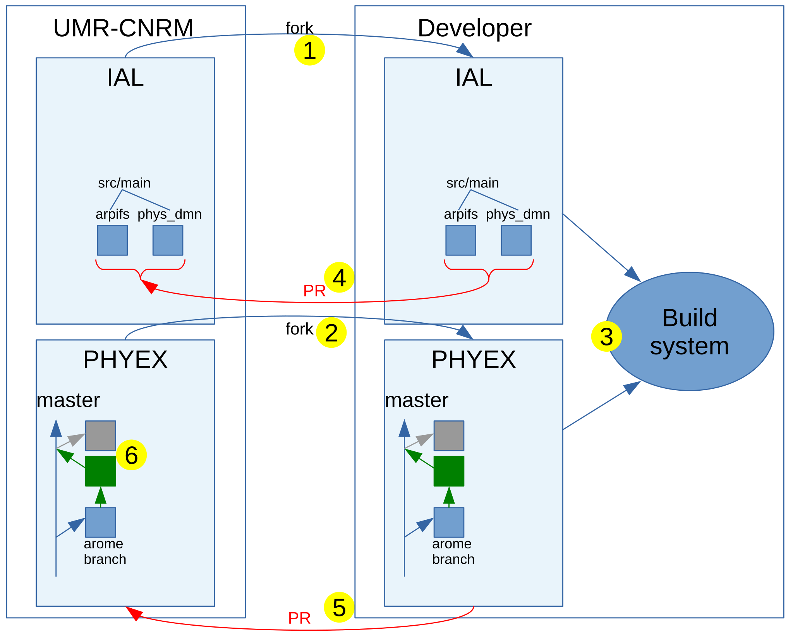

# PHYEX DEVELOPER DOCUMENTATION

## About this section

This section is intended for developers who want to contribute to the PHYEX package.
Developer who is interested in plugging the physics in a new model can refer to the [Plugging documentation](./Plugging.md).
The topics covered are as follows:

  - [Package organisation](#package-organisation)
  - [Versions](#versions)
  - [Contribution workflow for AROME and HARMONIE-AROME developers](#contribution-workflow-for-arome-and-harmonie-arome-developers)
  - [Contribution workflow for Méso-NH developers](#contribution-workflow-for-méso-nh-developers)
  - [Contribution workflow for other developers](#contribution-workflow-for-other-developers)
  - [Code documentation](#code-documentation)

## Package organisation

The package contains two kinds of branches:

  - generic branches which contain codes for all the models and applications (eg: master branch)
  - model specific branches which are derived from the master branch (arome branch, mesonh\_\<commit\_hash\> branches)

For model specific branches, only the source code adapted for a given model is present (one directory per parametrisation and an aux directory). They are intended to be included directly in the compilation system of the hosting model.

The master branch contains the following directories and files:

  - src/phyex: the FORTRAN source code (aux, conv, micro, turb directories for the parametrisations, progs and support directories for the offline test programs), its CMake build system (CMakeLists.txt and cmake directory), the version number (VERSION file) and the description of the model versions used to test PHYEX (\<model\>\_version.json files)
  - src/pyphyex: the python package (python binding and 1D model, see the [phyex1d documentation](./phyex1d.md))
  - CMakeLists.txt and cmake: CMake build system of the whole package (with its dependencies), see the [Offline documentation](./Offline.md)
  - pyproject.toml: build of the python package
  - arch: architecture files (compilation environments)
  - tools: python package (pyphyextools) containing the tools to prepare the source code and to check the contributions (see the [Tools documentation](./Tools.md)), and the configuration of the IAL test cases (tools/conf\_tests)
  - clone\_and\_test.sh: script for the automatic tests (see the [Tools documentation](./Tools.md))
  - docs: this documentation

The model specific branches are:

  - arome: source code for the AROME and HARMONIE-AROME models, automatically updated (by the arome\_branch GitHub workflow) at each new commit on the master branch
  - mesonh\_\<commit\_hash\>: source code for the Méso-NH model, built from a given commit of the master branch

In addition, the testprogs\_data, testprogs\_data2 and testprogs\_data3 branches contain modified source code used to generate the input data of the test programs (more on this topic in the [Offline documentation](./Offline.md)).

## Versions

Versions of the master branch are tagged with tags named "vX.Y.Z" (for example "v1.0.0").
The commit of the arome branch corresponding to this version is tagged "vX.Y.Z\_arome" (for example "v1.0.0\_arome").
The version number is only stored in the src/phyex/VERSION file (used by CMake, the python package and the python tools): it must be updated before tagging a new version.
The "consistency" GitHub workflow (or the phyex-check\_consistency tool) checks that it is the version of the last release tag.

## Contribution workflow for AROME and HARMONIE-AROME developers

AROME and HARMONIE-AROME are built as a _bundle_: the model is built with source codes coming from various repositories. The PHYEX source code is no longer included in the IAL repository: the bundle description (bundle/bundle.yml file of IAL) references the version (commit of the arome branch) of PHYEX to use.

The AROME and HARMONIE-AROME developers only see the code of the arome branch. This code is ready for inclusion (array-syntax already transformed into DO loops for instance): developers do not need to manipulate code transformation tools.

Workflow details (getting the source code in blue, pull request in red, integration in green):

  - 1 and 2: the AROME or HARMONIE-AROME developer forks the IAL and PHYEX repositories (the work on PHYEX is based on the arome branch)
  - 3: the developer compiles, executes, modifies the source code in its environment (the bundle description of its IAL working branch references its PHYEX fork and working branch)
  - 4: the developer sends a pull request to the arome branch of the PHYEX repository
  - 5: if the interfaces between PHYEX and the rest of the model are modified, the developer also sends a pull request to the IAL repository (with the modifications of the CALL statements)
  - 6: the pull request is first integrated in PHYEX by the PHYEX administrator (who reports the modifications in the master branch, the arome branch being updated automatically, see the [Integrator documentation](./Integrator.md)). Then, a new commit is added on the IAL working branch to reference the new PHYEX commit (arome branch) in the bundle/bundle.yml file of IAL, and the IAL integrator integrates the IAL pull request.

## Contribution workflow for Méso-NH developers

The physics source code is embedded in the Méso-NH source code.

The physics source code comes directly from a mesonh specific branch (these branches are named mesonh\_\<commit\_hash\>) which contain code ready for use in the Méso-NH model (array-syntax...).

Pull requests concerning the physics continue to follow the same path as before (ie pull requests are submitted to the Meso-NH repository). The Meso-NH integrator will submit a pull request to the PHYEX repository with only the relevant files.

## Contribution workflow for other developers

Other developers must work with source code coming directly from the master branch. They issue pull requests directly on this branch as usual with git repositories.

Before submitting a pull request, the contribution can be checked with the tools described in the [Tools documentation](./Tools.md) (phyex-check\_norms for the coding norms, phyex-check\_testprogs for the bit-reproducibility of the test programs, phyex-check\_commit for all the checks).

## Code documentation

The code must contain comments.
The documentation rules to follow are described in the [CodingNorms](./CodingNorms.md) document.
