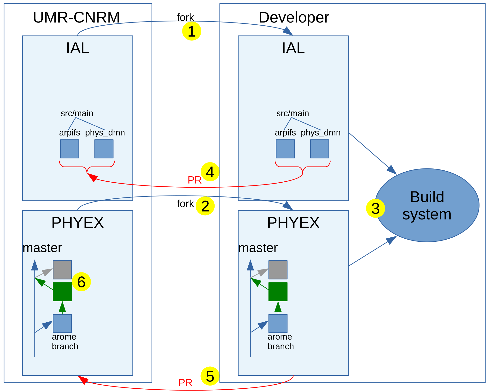

# PHYEX INTEGRATOR DOCUMENTATION

## About this section

This document is intended for integrators who are in charge of assembling contributions received through pull requests.

## Branches and norms

Regarding array-syntax, the [applicable norm](./CodingNorms.md) depends on the branch:

  - The master branch is written using array-syntax with mnh\_expand directives
  - The arome branch is written using DO loops
  - mesonh specific branches are written using array-syntax

Pull requests can be received on all these kind of branches and must be merged into the master branch with according norm.

## Normal workflow for a contribution developed in AROME and HARMONIE-AROME

The pull request comes directly from a developer. It must be based on the arome branch. When the interfaces with the rest of the model are modified, a pull request is also sent to the IAL repository (modifications of the CALL statements).

Details for point 6:

  - The PHYEX administrator
    - validates the contribution (see [below](#tests))
    - integrates the modifications in the master branch (written with the array-syntax and mnh\_expand directives); the arome branch is then updated automatically (see [below](#code-preparation))
    - regularly, tags a new (minor) version of the master branch
  - Then, a new commit is added on the IAL working branch (on which the IAL pull request is based) to reference the new PHYEX commit (arome branch) in the bundle/bundle.yml file of IAL
  - The IAL integrator integrates the IAL pull request

### PHYEX - IAL compatibility

Because the interfaces between the physics and the rest of the model can change, the IAL version to use with PHYEX must be referenced in the 'src/phyex/ial\_version.json' file (repository, commit and cycle of IAL, used by the phyex-check\_ial tool).
On the IAL side, the PHYEX version is referenced in the bundle/bundle.yml file.

In addition, if some files must be excluded from the IAL compilation, they must be listed in the 'src/phyex/gmkpack\_ignored\_files' file.

## Normal workflow for a contribution developed in MESONH

The developer sends its pull request on the Méso-NH repository (the physics source code is embedded in the model source code).

Integration details:

  - The Meso-NH integrator extracts, from the different pull requests, what concern the PHYEX repository and send a pull request on PHYEX based on a mesonh specific branch
  - The PHYEX administrator:
    - validates (see [below](#tests)) the contribution
    - integrates the contribution in the mesonh branch and merges it in the master branch
    - regularly, he tags a new (minor) version of the master branch
    - when asked by the Meso-NH integrator, he builds a new mesonh specific branch (see [below](#code-preparation))
    - when a mesonh specific branch is used in an official release, the mesonh specific branch is tagged accordingly

The Meso-NH version used to test PHYEX is described in the 'src/phyex/mesonh\_version.json' file.

## Normal workflow for another contribution

Pull requests must be based on the master branch.

The PHYEX administrator:

  - validates (see [below](#tests)) the contribution
  - integrates the contribution in the master branch
  - regularly, he tags a new (minor) version of the master branch

## Tests

The source code must follow the coding norms and the strict mnh\_expand directives (described in the [Coding Norms documentation](./CodingNorms.md)). They are checked by the phyex-check\_norms tool (also run by the "tests" GitHub workflow).

In addition to the scientific validation, the following tests must give the same results (with bit-reproducibility) in each of the model (arome, mesonh, lmdz and testprogs):

  - compilation transforming the mnh\_expand directives in DO loop
  - compilation keeping the array-syntax
  - execution with a different number of processors

When possible, the new version of PHYEX must reproduce the old results (scientific modifications must be activated with namelist keys).

These tests are performed by the phyex-check\_\<model\> tools; the reference commits for the test cases of each model are given in the 'testing' entry of the src/phyex/\<model\>\_version.json files.
The phyex-check\_commit tool performs all the checks (coding norms, consistency, documentation generation, python wheel creation and test cases of the different models) and the clone\_and\_test.sh script can run them automatically (e.g. by cron) on the last commit of a branch, the result being attached to the commit on GitHub. These tools are described in the [Tools documentation](./Tools.md).

## Code preparation

The source code stored in the master branches must be usable by all the models. But these models can have contradictory constraints. To bypass this difficulty, the source code is preprocessed before being included in the compilation environment of each model.

This preprocessing step can be done on the fly (in this case the preprocessing tools must be available aside of the compilation tools, it is the case of the CMake build system of PHYEX, see the PHYEX\_TRANSFORMATION option in the [Offline documentation](./Offline.md)), or the result of the preprocessing can be stored in the PHYEX package (in this case, the preprocessing is done once and can be used by several users).
This second possibility is useful to historize the source code really used during the model compilation and enables contributions to the PHYEX package without the need of the preprocessing tools.

The preprocessed versions of the source code are put in model specific branches:

  - the arome branch is updated automatically, at each new commit on the master branch, by the arome\_branch GitHub workflow (each commit of the master branch is transformed and committed on the arome branch)
  - the mesonh\_\<commit\> branches, where \<commit\> is the commit hash used as a basis, are built by the PHYEX administrator with the phyex-prep\_code tool

The preprocessing tools are described in the [Tools documentation](./Tools.md).
